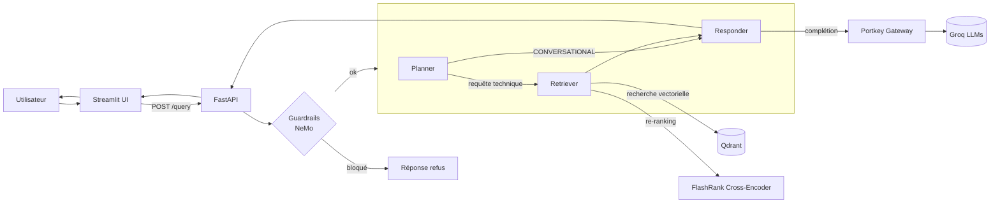
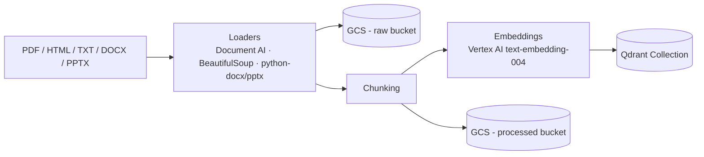

# 🤖 GRADE-RAG — Enterprise Agentic RAG

Assistant IT d'entreprise basé sur un pipeline **RAG agentique** (LangGraph) spécialisé sur la documentation technique interne : **Kubernetes, matériel Intel, réseaux (100G, EPT/paging, etc.)**.

Le système décide lui-même s'il doit répondre à partir de la mémoire de conversation ou aller chercher du contexte dans une base vectorielle, filtre les questions hors-sujet / jailbreaks via des guardrails, puis synthétise une réponse via un LLM passant par une gateway avec cache et fallback.

---

## ✨ Fonctionnalités

- **Agent LangGraph** avec état persistant (`planner → retriever → responder`), mémoire de conversation par `thread_id` (`MemorySaver`).
- **Planner intelligent** : distingue une question conversationnelle (répondable avec l'historique) d'une question technique nécessitant une recherche documentaire.
- **Retrieval hybride** : recherche vectorielle dans **Qdrant** (top 15) + **re-ranking sémantique** via un cross-encoder local (**FlashRank**, ONNX) pour ne garder que les 5 passages les plus pertinents.
- **Guardrails** (NeMo Guardrails + Colang) : blocage des questions hors-sujet et des tentatives de jailbreak avant même d'entrer dans le graphe.
- **Gateway LLM (Portkey)** : routage des appels Groq avec cache sémantique, retries et fallback automatique sur un modèle plus léger en cas d'erreur.
- **Ingestion universelle** : PDF (OCR via Google Document AI), HTML, TXT, DOCX/PPTX → chunking → embeddings (Vertex AI `text-embedding-004`) → indexation Qdrant, avec stockage des fichiers bruts/traités sur GCS.
- **Observabilité** : tracing distribué de bout en bout avec **Logfire**, intégration **LangSmith**.
- **Évaluation** : pipeline **RAGAS** (Faithfulness, Answer Relevancy, Context Precision/Recall, Answer Correctness, Tool Correctness) sur un jeu de données "golden".
- **UI Streamlit** : chat avec affichage du raisonnement de l'agent, des sources récupérées et du statut du cache.
- **API FastAPI** prête pour la production, conteneurisée avec Docker.

---

## 🏗️ Architecture



**Pipeline d'ingestion :**



---

## 🧰 Stack technique

| Catégorie | Technologies |
|---|---|
| API / UI | FastAPI, Uvicorn, Streamlit |
| Orchestration agent | LangGraph, LangChain |
| LLM / Gateway | Groq (Qwen3-8/27B), Portkey AI (cache + fallback) |
| Vector DB | Qdrant |
| Embeddings | Google Vertex AI (`text-embedding-004`) |
| Re-ranking | FlashRank (ONNX, cross-encoder local) |
| Ingestion | Google Document AI (OCR PDF), BeautifulSoup, python-docx/pptx, pypdf |
| Guardrails | NeMo Guardrails (Colang) |
| Observabilité | Logfire, LangSmith |
| Évaluation | RAGAS, DeepEval |
| Stockage | Google Cloud Storage (fichiers bruts et traités) |
| Infra | Docker |

---

## 📁 Structure du projet

```
GRADE_RAG/
├── app/
│   ├── main.py                  # Point d'entrée FastAPI
│   ├── config.py                # Configuration centralisée (variables d'env)
│   ├── agents/
│   │   ├── graph.py              # Définition du graphe LangGraph (planner/retriever/responder)
│   │   ├── state.py              # Schéma d'état de l'agent
│   │   └── nodes/                # planner.py, retriever.py, responder.py
│   ├── gateway/
│   │   └── client.py              # Client LLM via Portkey (cache, fallback)
│   ├── guardrails/
│   │   ├── rails.py                # Initialisation & exécution des NeMo Guardrails
│   │   └── colang_rules.py          # Règles Colang (off-topic, jailbreak, dialogue)
│   ├── ingestion/
│   │   ├── processor.py             # Orchestration ingestion (scan → parse → chunk → embed → index)
│   │   ├── loaders/                  # pdf.py, html.py, text.py, office.py
│   │   └── chunking/
│   │       └── splitter.py            # Découpage du texte en chunks
│   └── services/
│       └── retrieval/
│           ├── qdrant_service.py       # Recherche vectorielle Qdrant
│           ├── embedding.py             # Génération d'embeddings (Vertex AI)
│           └── ranking_service.py       # Re-ranking sémantique (FlashRank)
├── ui/
│   └── app.py                     # Interface de chat Streamlit
├── evals/
│   ├── pipeline.py                 # Orchestration des évaluations
│   ├── metrics.py                   # Métriques RAGAS (6 expériences)
│   ├── guardrails_eval.py            # Évaluation des guardrails
│   └── golden_dataset.json           # Jeu de données de référence
├── DATA/
│   ├── true_data/                   # Documents de référence (docx, pptx, html, txt)
│   └── noisy_data/                   # Documents "bruyants" pour tester la robustesse
├── notebook/
│   └── evals.ipynb                  # Exploration et expérimentation
├── Dockerfile
├── pyproject.toml / requirements.txt
└── uv.lock
```

---

## 🚀 Démarrage

### Prérequis

- Python ≥ 3.11
- Un gestionnaire de paquets : [`uv`](https://docs.astral.sh/uv/) (recommandé) ou `pip`
- Comptes/accès : **Google Cloud** (Vertex AI, Document AI, GCS), **Qdrant** (cloud ou local), **Groq**, **Portkey**, et optionnellement **Logfire** / **LangSmith**

### Installation

```bash
git clone https://github.com/<ton-org>/GRADE_RAG.git
cd GRADE_RAG

# avec uv
uv sync

# ou avec pip
pip install -r requirements.txt
```

### Configuration

Crée un fichier `.env` à la racine du projet avec les variables suivantes :

```env
# --- Google Cloud ---
PROJECT_ID=
LOCATION=us-central1
GCP_DOC_AI_LOCATION=us
GCP_DOC_AI_PROCESSOR_ID=
GCP_RAW_BUCKET=
GCP_PROCESSED_BUCKET=

# --- Qdrant (vector DB) ---
QDRANT_API_KEY=
QDRANT_CLUSTER_ENDPOINT=

# --- Groq (LLM) ---
GROQ_API_KEY=
GROQ_API_KEY_FALLBACK=

# --- Portkey (LLM gateway) ---
PORTKEY_API_KEY=
PORTKEY_CONFIG_SLUG=

# --- Observabilité ---
LOGFIRE_TOKEN=
LANGSMITH_API_KEY=
LANGSMITH_TRACING=true
LANGSMITH_PROJECT=grade-rag

# --- Backend (utilisé par l'UI) ---
BACKEND_URL=http://localhost:8080
```

> ⚠️ Ne commite jamais ce fichier. Il est déjà ignoré via `.gitignore`.

### 1. Ingestion des documents

Indexe les documents du dossier `DATA/` (ou un autre dossier) dans Qdrant :

```bash
python -m app.ingestion.processor DATA
```

Options :
```bash
python -m app.ingestion.processor <dossier> <source_type> --wipe   # --wipe réinitialise la collection
```

### 2. Lancer l'API

```bash
uvicorn app.main:app --host 0.0.0.0 --port 8080 --reload
```

- `GET /` → statut de l'API
- `GET /graph` → image PNG du graphe LangGraph
- `POST /query` → `{ "q": "...", "thread_id": "..." }`

### 3. Lancer l'interface de chat

```bash
streamlit run ui/app.py
```

### 4. Lancer les évaluations

```bash
streamlit run evals/app.py
```

---

## 🐳 Docker

```bash
docker build -t grade-rag .
docker run --env-file .env -p 8080:8080 grade-rag
```

---

## 🛡️ Guardrails

Toute requête utilisateur passe d'abord par **NeMo Guardrails** avant d'atteindre l'agent LangGraph :
- questions hors sujet → refusées avec un message de recadrage ;
- tentatives de jailbreak → bloquées ;
- salutations / small talk → gérées via des flows de dialogue dédiés.

---

## 📊 Observabilité & évaluation

- Chaque étape (planning, retrieval, reranking, génération) est tracée via **Logfire** (spans nommés) et **LangSmith**.
- La qualité du pipeline RAG est mesurée via **RAGAS** sur 6 axes : *Faithfulness*, *Answer Relevancy*, *Context Precision*, *Context Recall*, *Answer Correctness*, *Tool Correctness*.

---

## 📄 Licence

À définir.
